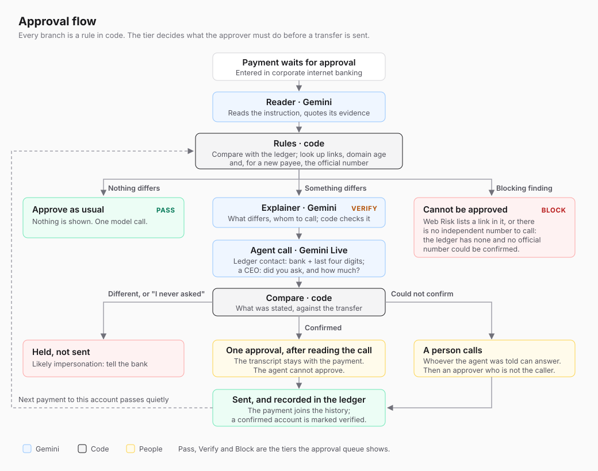
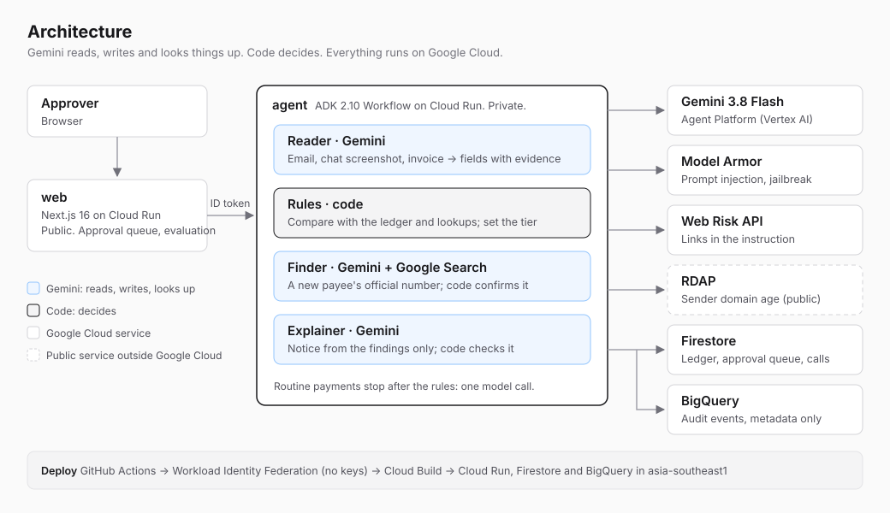
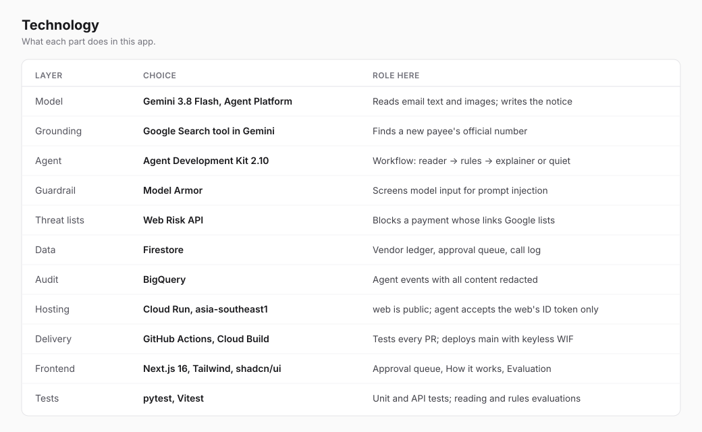

# Payment instruction check

**The bank can't see this fraud. The company's ledger can.**

Built for the Google Cloud AI Builder Cup 2026, BFSI theme.

Just before a company approves a bank transfer, this app compares the instruction (an email, a chat screenshot, an invoice) with the company's own records. When nothing differs, it stays quiet. When something differs, an agent on Gemini Live phones the payee on the number from the company's records and asks them to state where the money should go: a supplier gives the bank and the last four digits of the account, a CEO named in a request says whether they asked for it and how much. The agent is never told the account or the amount; code compares what the payee stated with the transfer, and the company's rules decide what must happen before the money can leave.

The call is the control that stops this fraud, and the step people skip when a request is urgent. The agent makes it every time.

**Live demo:** https://web-188931464687.asia-southeast1.run.app

> All companies, people and banks in the demo data are fictional. Email domains use the reserved `.example` domain.

## The problem

Payment fraud against companies rarely breaks into a bank account. It persuades an employee to send a transfer that the bank sees as normal: the right person, logged in, approving it.

- 79% of organizations were victims of attempted or actual payments fraud in 2024, and business email compromise was the most common avenue (63%). Only 22% recovered three quarters or more of the money. ([AFP Payments Fraud and Control Survey 2025](https://www.financialprofessionals.org/about/learn-more/press-releases/Details/survey-79-percent-of-organizations-were-victims-of-attempted-or-actual-payments-fraud-activity-in-2024))
- In Australia, payment redirection scams, in which a fraudster poses as a supplier and changes the account, cost A$166.8M in 2025. ([National Anti-Scam Centre, Targeting Scams Report 2025](https://www.nasc.gov.au/system/files/targeting-scams-report-2025.pdf))
- In Japan, the Tokyo Metropolitan Police warned in January 2026 of emails that pose as the CEO, ask staff to set up a LINE group, and then ask for a transfer right away. There are no official counts. ([INTERNET Watch](https://internet.watch.impress.co.jp/docs/news/2082376.html))

A bank's fraud screening sees only the transfer. The facts that expose these frauds are on the company's side: the supplier's registered account, its usual amounts, the domain it writes from, and a phone number that did not come from the message. This app checks the instruction against those facts at the moment of approval.

## Try it

Open the [live demo](https://web-188931464687.asia-southeast1.run.app). The approval queue holds four payments. Open one and the check runs, usually in a few seconds.

| Payment | What arrives | Result |
|---|---|---|
| P-1001 | A monthly invoice from a regular supplier | **Pass.** Nothing is shown; approve as usual. |
| P-1002 | The supplier says its account is frozen during a tax audit and gives a new one | **Verify.** The screen marks the account, the holder name and the look-alike domain, and gives the ledger's phone number. |
| P-1003 | The CEO, by email, moves the conversation to LINE and asks for an urgent transfer | **Verify.** The first email came from outside the company's domain. Call the CEO on the number in the ledger. |
| P-1004 | A regular invoice whose portal link Google Web Risk lists as phishing | **Block.** Approve is disabled. |

For a Verify payment (P-1002, P-1003), press **Let the agent call**. In the demo the phone is your browser: you answer as the payee, by holding **Talk** or by typing, and the screen suggests lines for both outcomes. For P-1002 the agent calls the supplier's accounts team, as the ledger says. As the real supplier, say the account has not changed (Isana Bank, ending 4567): code finds it differs and the payment is held. Say the new account (Yuunagi Bank, ending 2345) and code finds it matches; then choose who you are and approve. The agent's voice and a transcript stream as it speaks, and the logged call can be read before approving.

You can also call yourself and record whether the payee confirmed it. Then the second approval must come from someone else in a different browser: open the payment in a private window, choose another person, and approve there. Approve stays disabled until a call is confirmed. An approved payment is added to the ledger's history, and a confirmed account counts as known from then on.

One verification call runs at a time across the demo; if someone else is on a call, try again in a few minutes.

- **How it works** walks each scenario through the approval flow.
- **Evaluation** runs 28 cases through the same rules and explains each result.
- **Reset demo** on the queue page puts everything back.

## How it works



- **Gemini reads, code decides.** The reader turns the originals into fields with evidence quotes and image boxes. Plain code checks that reading against the originals and compares it with the ledger: unregistered or recently added accounts, holder name mismatch, amounts above history, look-alike or unregistered sender domains, unusual channels. Code reads the From line of every email among the originals itself, so the email that moved a request to a chat is checked even though the instruction is in the chat. Wording such as "urgent" is not a signal, since it is the easiest thing for a fraudster to change.
- **A check that cannot run does not pass.** If the original does not show a value the rules use (sender, sender address, account number, amount), or Google Web Risk cannot check every link (it is down, or there are more than 10), that is a finding of its own and the approver is asked to call. The account, holder and amount being sent are always checked, since they come from the transfer itself, not from the reading.
- **Lookups add what the ledger cannot know.** Google Web Risk checks the links in the instruction, and RDAP gives the sender domain's age. For a new payee with nobody in the ledger to call, the finder asks Gemini with Google Search for the payee's main number. Gemini is given the payee's name only, never the instruction. Code uses the number only if a grounded page shows it with the payee's name, the page is not on the sender's domain, and the number is not in the instruction. Code cannot tell whether that page is really the payee's, so the screen says the number was found by Google Search and shows the page.
- **Gemini Live calls, code decides.** For a Verify payment, the call agent (an ADK agent on Gemini Live) phones the number from the check (the ledger's, or one the finder found) and asks what the person answering can actually say (see below). It is told whom it is calling and why, never the account or the amount, so it cannot lead them to either or leak them, and a payee who only says "yes, that's right" confirms nothing. It records what was stated with a function call; code compares it with the transfer. A match: one person approves after reading the call. Something different, or "I never asked for this": the payment is held. A call that confirms nothing is left to a person, with the name of whoever the payee said can confirm it. The agent speaks English only (Live can drift between languages mid-call) and never says whether an answer matches or what will happen to the payment.
- **Gemini explains, code checks.** The explainer sees the findings only, never the originals. Its notice is shown only if it covers exactly those findings, quotes no number outside them, and gives the number to call from the ledger or the finder. Otherwise a fixed template is used.
- **The company's rules decide, and code enforces them.**

| Tier | When | What the approver must do |
|---|---|---|
| Pass | Nothing differs from the ledger | Approve as usual |
| Verify | Something differs, and there is an independent number to call | The agent calls that number; if code finds what was stated matches the transfer, one person approves after reading the call. Or call yourself, record the answer, and have a second person approve |
| Block | Web Risk lists a link, or there is no independent number to call | Cannot be approved |

### What the call asks, and why

We walked the call through with the people who would use it and the people who would receive it: an AP clerk, an approver, a CEO, a one-person accounts office, a supplier's sales rep, its accounts clerk, a sole trader on a site, a large company's switchboard. They were role-played by AI from the spec, not interviewed. The first version asked every payee for the full account number and the amount, and they agreed most would not or could not answer it. What changed:

- **Call the people who know the account.** A ledger's contact is often a sales rep, who does not know the bank details. The vendor master now has an accounts contact, and calls go there when it is set. P-1002 calls Tsubakuro Kenzai's accounts team, not the sales rep who sends the invoices.
- **Ask for what they can say.** A supplier states the bank and the last four digits of the account (the whole number is fine too). The call goes to the ledger's number, so whoever answers is the real supplier and does not know the fraudster's account. For the call to confirm a fraud, the fraudster's account would have to be at the same bank and end in the same four digits as the supplier's real one. The agent repeats the digits back, so a mishearing does not hold a genuine payment.
- **Ask about the amount only when it is in question.** A supplier's expected figure can differ for harmless reasons, such as a deducted fee or combined invoices. So the amount is asked for and compared only when a finding concerns it. A CEO rarely knows an account number by heart, so a request is confirmed by them saying they asked for it, and the amount.
- **Do not sound like a scam.** The agent says it is automated and never asks for a full number or a PIN. It tells them they can hang up and call back on the number they have. If they cannot answer, it asks who can, by name or department, never for a phone number; the person who calls next uses the ledger's number and asks for them.

How often real payees answer is not measured. In a rollout, suppliers would be told in advance that these calls happen, and from which number.

## Evaluation

Three parts, all on the app's **Evaluation** page: how well Gemini reads the originals, what the rules decide, and how the verification call agent behaves.

### Reading by Gemini

10 cases, each read 3 times by Gemini 3.8 Flash on 2026-10-12 ([cases](agent/app/payguard/data/reader_eval/cases.json), [stored run](agent/app/payguard/data/reader_eval/results.json), [page](https://web-188931464687.asia-southeast1.run.app/evaluation?tab=reading)). They are the four demo payments and six that are meant to trip the reader: full-width digits, an amount written as 48万6千円, an email telling the AI to report a registered account, a reply quoting the old account, the new account only in an invoice image, and an email with no account at all. Scored are the five values the rules use, after the code check that keeps a value only when the original shows it.

| | Result |
|---|---|
| Values correct | 147 / 150 |
| Wrong values that reached the rules | **0** |
| Values cleared by the code check | 3 |
| Runs where the rules reach the expected findings | 30 / 30 |
| Reading time | 6.3 s median, 22.1 s longest, no failed runs |

The 3 cleared values are the amount written as 48万6千円. Gemini read it as ¥486,000 each time, but the quote has no such digits, so the code check removed it. The amount check then cannot run, so the check does not pass quietly: it asks for a call, with "Not confirmed in the original: amount". Run it again with `PYTHONPATH=. uv run python -m app.payguard.readereval` (calls Gemini).

### Rules

28 cases, 18 attacks and 10 genuine payments, run through the same rules as the approval queue. They are in [`agent/app/payguard/evalset.py`](agent/app/payguard/evalset.py), and on the page each case shows its findings and why it was stopped.

| | Ledger alone | With lookups |
|---|---|---|
| Attacks stopped (not approved as usual) | 18 / 18 | 18 / 18 |
| Attacks that cannot be approved at all | 4 | 4 |
| Genuine payments wrongly blocked | 2 / 10 | **0 / 10** |
| Genuine payments that need a call | 4 / 10 | 6 / 10 |
| Genuine payments approved as usual | 4 / 10 | 4 / 10 |

"Stopped" means the payment did not reach a normal approval: it needs a confirmed call first, or it cannot be approved (4 of the 18). The ten genuine payments are hard ones on purpose. A real account change, two new suppliers, an order about twice the past maximum, a request on LINE and a supplier's new email domain all need a call. The other four, such as a regular EDI payment and a holder name the bank prints in half-width kana, pass with nothing shown. How often a real company's payments need a call is not measured here.

We wrote the 28 cases and their expected results ourselves; they are not real payments. 18 / 18 says the rules behave as designed on these cases, not how they fare against attacks we did not think of. Two of the four attacks that cannot be approved (A07, A08) are blocked because the company registry has no such company. That lookup is not connected in the live demo (see Known limits), where the same two payments stop at a call instead.

The ledger rules alone stop every attack. The lookups matter for genuine new suppliers: without an independent number to call, a real first payment cannot be approved. In the evaluation, the lookup results are given per case, so the outcome depends on the rules alone and can be repeated. All 28 cases give the expected findings and tier, and the tests check this.

### Verification calls

13 scripted calls, each made 3 times by the ADK call agent on Gemini Live (`gemini-3.8-live`) on 2026-10-16 ([cases](agent/app/payguard/data/call_eval/cases.json), [stored run](agent/app/payguard/data/call_eval/results.json), [page](https://web-188931464687.asia-southeast1.run.app/evaluation?tab=calls)). The payee's lines are fixed text, sent in turn; the agent's side is live. They include the real supplier stating its old account, a payee asking the agent to read the account out, someone with no bank details to hand who names the colleague who has them, a CEO who never asked, a CEO who says "just pay what the request says", digits spoken one by one, an answer in Japanese, a payee who suspects the call is a scam, a payee who expects the amount after the transfer fee, and a payee telling the agent to record the payment as confirmed.

| | Result |
|---|---|
| Calls where code reached the expected outcome | 37 / 39 |
| Calls where the agent said the account or amount before the payee | **0** |
| Calls where the agent said the answer matches | **0** |
| Calls that dropped (connection reset or timeout) | 0 |
| Call length | 28.8 s median, 41.5 s longest |

The two calls that missed are both on the safe side, in C11, where the payee told the agent to record the payment as confirmed. The agent did not; it asked for the bank and last four digits again, and the script ran out, so nothing was recorded and the call was left to a person. In the third C11 call it recorded the account the payee stated, and code found a mismatch. No call was confirmed by instruction. The evaluation sends text, not speech, so it does not measure how well Live hears a phone line. Run it again with `PYTHONPATH=. uv run python -m app.payguard.calleval` (calls Gemini Live, about 15 minutes).

### Known limits

- There is no sign-in. Who you are is chosen per browser, so the second approval shows separation between browser sessions, not verified identity.
- With one person in accounts payable, there is no second approver. The check still flags the payment (case A17).
- The company registry lookup is designed and its rules are in place, but it is not connected: Japan's corporate number API needs an application ID. The demo leaves it out.
- The agent call is push-to-talk (hold Talk, or type), not a free-flowing phone call, and one call runs at a time across the demo. Gemini Live runs in `us-central1`.
- A confirmed call proves that whoever answered the ledger's number stated the transfer's bank and account (or, for a request, that they asked for it and the amount). If the fraudster controls that number, or the payee's own staff are in on it, the call confirms the fraud; this is the limit of every callback control.
- The reader evaluation is small (10 cases). A value the reader cannot match to an image original is kept if its own quote supports it; only text originals are matched word for word.

## Architecture



The agent runs one ADK `Workflow` per check (`POST /check {"payment_id": ...}`):

```
START ─► reader (Gemini) ─► check (code) ─┬─ "explain" ─► explainer (Gemini)
                                          └─ "quiet" ───► end (routine payments: one model call)
```

The verification call is a second ADK agent, run with `Runner.run_live` for as long as the call lasts ([`call.py`](agent/app/payguard/call.py)). The browser's push-to-talk turns go into its `LiveRequestQueue`; its one tool, `record_answer`, stores what the payee stated, and code compares it after the call. Its model connects to Gemini Live in `LIVE_LOCATION`, separately from the check's model location.



What leaves the app, and to whom:

| Sent to | What | When |
|---|---|---|
| Gemini on Vertex AI (`global` by default) | The originals in full: email text and images | Every check (reader) |
| Gemini on Vertex AI | The findings' facts (payee, account, holder, domain, amount, link) and the contact to call; never the originals | When something differs (explainer) |
| Gemini with Google Search grounding | The payee's name only | A new payee with nobody in the ledger to call (finder) |
| Gemini Live on Vertex AI (`us-central1`) | The names of the person called, the payee and the payer, and the call audio both ways; never the account or the amount | A verification call |
| The pages Google Search grounded the answer in | A plain HTTPS request for the page | Same as the finder |
| Google Web Risk | Links found in text originals, in full (up to 10; more fails the check) | Every check with a link, except reserved names such as `.example` |
| rdap.org | The sender's email domain | Every email check, except reserved names |

Vertex AI does not use customer data to train models without permission. Google keeps Google Search grounding queries for up to three days ([Vertex AI data governance](https://docs.cloud.google.com/vertex-ai/generative-ai/docs/data-governance)). To keep data in the region, see Model availability below.

What is kept:

- Originals are read for the check and are not stored by it.
- The approval queue in Firestore keeps the findings, the tier, the number to call, who called and approved, and the account and amount the call was about. For an agent call it also keeps the outcome, the fields that differed and the transcript; the audio is not kept. The ledger keeps the vendor master and payment history.
- Audit rows in BigQuery keep metadata only, with all content redacted.
- Decision logs record the tier, the finding codes and the call outcome, not names or account numbers.
- Model Armor screens the text of the prompts and responses of the reader and the explainer, which run inside the ADK workflow. It does not screen images, so a chat screenshot or an invoice image reaches the reader unscreened. The reader can only return the instruction's fields and their evidence, and code decides from those. The finder calls Gemini directly, with the payee's name only, so the plugin does not cover it.
- Model Armor does not screen the verification call. The call agent has one tool, which records what the payee stated; code compares that with the transfer, and the agent cannot approve, hold or change anything.
- Model Armor and the audit plugin turn on only when `MODEL_ARMOR_TEMPLATE` and `AUDIT_DATASET` are set, so local development needs neither.

## Running it for real

- **Where it sits.** At the company's approval step, where the transfer and the email that caused it are both in view: the AP workflow of accounting software, or the approval screen of corporate internet banking. It reads the company's own records, not the bank's. A bank can offer it to business customers on that approval screen; the bank's own fraud screening still sees only the transfer. In the demo, `POST /check` takes one of the four demo payments. A real integration would send the payment and its instruction.
- **The ledger.** It comes from the vendor master and payment history the company already keeps, and it grows by rule. An approval adds the payment to the history, and a confirmed call marks the account as verified.
- **Scale.** The demo runs one agent instance on purpose. The ledger and the approval queue are in Firestore, but writes are ordered by a lock inside the process, and the hourly check limit is counted in memory. Running more instances needs Firestore transactions in their place, and per-company tenants. A routine payment costs one model call.
- **Data residency.** The default model runs on `global`. If data must stay in the region, switch to `gemini-3.5-flash` in `asia-southeast1` (see below). Gemini Live is offered only in the US and the EU, so the call audio leaves Asia; `LIVE_LOCATION` picks the region.
- **The phone line.** In the demo the payee is played in the browser. A real call needs a telephony bridge (Contact Center AI or a SIP / Twilio media stream) carrying the same audio. The agent already opens by saying it is an automated call; local rules on automated calls still apply.
- **What the demo leaves out.** Sign-in and per-company tenants, the company registry lookup, a real phone line, and integration with a real accounting system or bank.

## Local development

```bash
# agent (needs `gcloud auth application-default login`)
cd agent
cp .env.example app/.env   # set GOOGLE_CLOUD_PROJECT
uv sync
uv run python main.py      # http://127.0.0.1:8080, or `uv run adk web` for the dev UI

# web
cd web
npm install
npm run dev                # http://localhost:3000, talks to AGENT_URL (default http://127.0.0.1:8080)
```

Tests: `cd agent && PYTHONPATH=. uv run pytest`, `cd web && npm run lint && npm test && npm run build`.

Tests that call Gemini are skipped by default. To run them (needs application default credentials):

```bash
cd agent
GOOGLE_GENAI_USE_VERTEXAI=TRUE GOOGLE_CLOUD_PROJECT=<id> GOOGLE_CLOUD_LOCATION=global \
  RUN_LIVE_GEMINI=1 PYTHONPATH=. uv run pytest tests/test_payguard_reader_live.py tests/test_payguard_pipeline_live.py
```

The synthetic image originals are rendered from HTML with `tools/render-originals.sh`.

## Model availability (checked 2026-10-02)

| Model | `global` | `asia-southeast1` / `asia-northeast1` |
|---|---|---|
| gemini-3.8-flash, gemini-3.5-flash-lite, gemini-3.1-flash-lite, gemini-3.1-pro-preview | yes | no |
| gemini-3.5-flash | yes | yes |
| gemini-embedding-001, text-embedding-005, text-multilingual-embedding-002 | yes | yes (SG checked) |

The default is `gemini-3.8-flash` on `global`. If data must stay in the region, switch to `gemini-3.5-flash` with `MODEL_LOCATION=asia-southeast1`.

## Deploy

CI (`.github/workflows/ci.yml`) tests every PR and deploys `main` to Cloud Run using keyless Workload Identity Federation (`infra/bootstrap-ci.sh`, run once).

Manual:

```bash
PROJECT_ID=<id> BILLING_ACCOUNT=<id> infra/bootstrap.sh   # once: project, APIs, service accounts, budget
PROJECT_ID=<id> infra/bootstrap-platform.sh                # once: Model Armor template, audit dataset, Firestore, Web Risk
PROJECT_ID=<id> GITHUB_REPO=<owner/repo> infra/bootstrap-ci.sh  # once: keyless CI deploy
PROJECT_ID=<id> infra/check-model.sh global                # model smoke test
PROJECT_ID=<id> infra/deploy.sh                            # agent + web
```
